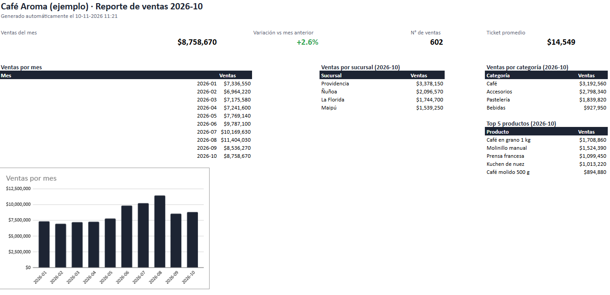
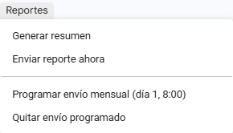
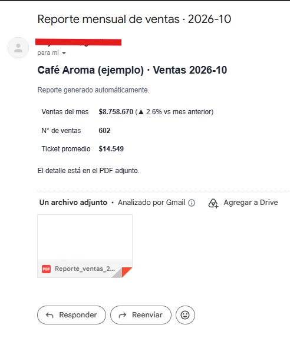

# 📧 Reporte mensual automático en Google Sheets · Apps Script

Automatización en **Google Sheets + Apps Script** para una pyme con varias sucursales. Toma la hoja de ventas tal como la llena el equipo, con errores de digitación incluidos. La limpia, arma un resumen con indicadores y gráfico, y **envía el reporte en PDF por correo el día 1 de cada mes**, sin intervención manual.

<!-- Reemplaza estas líneas por tus capturas (ver GUIA.md, paso 6) -->


| Menú "Reportes" | Correo recibido |
|---|---|
|  |  |

---

## Problema que resuelve

Cada mes, alguien copia las ventas de las sucursales, corrige montos escritos como texto ("$14.990"), elimina filas repetidas, arma tablas y gráficos, exporta un PDF y lo envía por correo. Son horas de trabajo manual, con riesgo de errores.

Con este proyecto, todo eso ocurre con **un clic**, o **solo**, en una fecha programada.

## Qué hace

1. **Limpia los datos** de la hoja `Ventas`:
   - Fechas en formatos mezclados (`05/03/2026` y `2026-03-05`).
   - Montos como texto (`$14.990`, `14.990`).
   - Espacios y mayúsculas inconsistentes (`  PROVIDENCIA `).
   - Filas vacías, incompletas y **duplicadas** (misma boleta y producto).
2. **Crea la hoja `Resumen`** del último mes:
   - Ventas, n° de ventas, ticket promedio y variación contra el mes anterior.
   - Ventas por mes, con gráfico.
   - Ventas por sucursal, por categoría y top 5 de productos.
3. **Envía el reporte**: un correo HTML con los indicadores y el PDF del resumen adjunto.
4. **Programa el envío** para el día 1 de cada mes a las 8:00, con un activador de tiempo.
5. **Registra cada ejecución** en la hoja `Registro`: filas leídas, válidas, descartadas y duplicadas.

Todo se maneja desde un menú **Reportes** dentro de la planilla. Los destinatarios y el nombre de la empresa se cambian en la hoja `Config`, sin tocar código.

## Resultado con los datos de ejemplo

| Indicador | Valor |
|---|---|
| Filas leídas | 5.764 |
| Filas válidas | 5.725 |
| Duplicadas detectadas | 25 |
| Inválidas descartadas | 6 |
| Ventas octubre 2026 | $8.758.670 (+2,6% vs septiembre) |

## Estructura

```
├── src/
│   ├── Limpieza.gs        # limpieza de datos (funciones puras)
│   ├── Calculos.gs        # agregaciones e indicadores (funciones puras)
│   ├── Reporte.gs         # hoja Resumen, gráfico, PDF y correo
│   ├── Menu.gs            # menú "Reportes" y envío programado
│   └── appsscript.json    # zona horaria y permisos
├── datos/
│   ├── ventas_ejemplo.xlsx  # hojas Ventas (con errores) y Config
│   └── ventas_ejemplo.csv
├── tests/test_logica.js   # pruebas de la lógica con Node, sin Google
├── scripts/generar_datos.py
└── GUIA.md                # instalación paso a paso
```

## Pruebas

La limpieza y los cálculos no dependen de Google, así que se prueban en local:

```bash
node tests/test_logica.js
```

## Tecnologías

Google Apps Script (JavaScript V8) · Google Sheets · SpreadsheetApp · MailApp · activadores de tiempo · exportación a PDF · Node.js (pruebas) · Python (generación de datos)

---

> Todos los datos son **ficticios**, generados con `scripts/generar_datos.py`.

**¿Quieres automatizar los reportes de tu negocio en Google Sheets?** Contáctame: clayer2001@gmail.com
